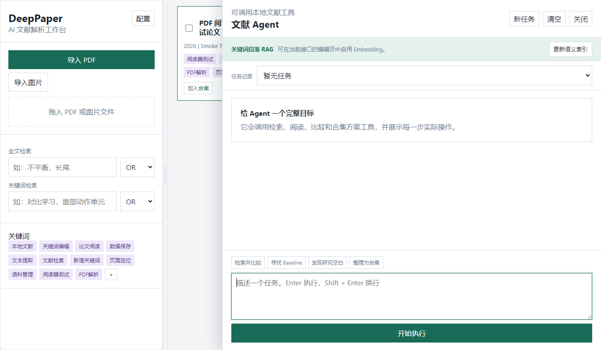
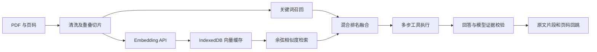

# DeepPaper

本地优先的学术文献 Research Agent，将 PDF 阅读、论文解析、混合检索和可回溯的正文证据放在同一个桌面工作区。

**当前源码版本：0.1.48。** 工程整理和新增功能记录在 [CHANGELOG](CHANGELOG.md)；GitHub 历史安装包不一定包含当前源码的全部功能。

[运行与测试](docs/development.md) · [架构说明](docs/architecture.md) · [评测计划](docs/evaluation.md) · [演示指南](docs/demo.md) · [升级路线](docs/roadmap.md)



上图来自隔离环境中的自动化测试，使用合成论文；展示实际界面，不代表真实模型回答或检索评测结果。

## 解决的问题

阅读一批论文时，研究者需要同时完成主题筛选、方法比较、证据核对和资料整理。DeepPaper 围绕这一工作流提供：

| 场景 | 当前实现 |
| --- | --- |
| 阅读与管理 | 批量导入 PDF/图片，PDF.js 阅读器、页内搜索、可调三栏、关键词编辑、合集和收藏 |
| 理解单篇论文 | 提取动机、贡献、方法、数据集、指标、关键词和局限，支持连续对话及附图 |
| 查找相关论文 | 全库 AI 按论文级字段召回，再将前 30 篇候选交给模型判断，可展开全部本地匹配 |
| 正文证据检索 | 页级清洗、重叠切片、关键词与可选 Embedding 语义召回、排名融合 |
| 跨论文研究 | Agent 自动选择检索、阅读、比较等本地工具，返回可定位原文的引用 |
| 资料沉淀 | 语料和历史批注兼容、JSON 文献库导入导出；创建合集需用户确认 |

例如，在资料充足的文献库中输入：“查找同时涉及长尾分类和知识蒸馏的论文，并比较方法与局限。”系统可检索论文和正文、读取相关材料，再给出带引用的回答；证据不足时应检查校验提示和原文。

## 技术实现



- **页级知识处理**：修复 Unicode 连字和部分英文断词，过滤重复页眉页脚；按页内段落/句子边界切分，默认目标约 820 字符、overlap 约 120 字符。
- **可追溯 Metadata**：保留论文 ID、章节、原始 PDF 页码、页内偏移、清洗版本和内容哈希；无法取得精确页码时标记估算值。
- **增量向量缓存**：相同正文复用本地向量，减少重复请求；Embedding 支持 OpenAI 兼容协议及火山方舟多模态协议，特定服务错误会缩小批次并有限重试。
- **混合检索**：自定义关键词打分与向量余弦相似度召回，通过带权排名融合及额外奖励项排序。未启用向量或向量不可用时回退关键词检索。
- **受限工具执行**：自定义 JSON 工具协议，最多 6 步；可执行论文/段落检索、上下文读取、论文比较和证据表构建；合集写入需确认。

实现使用 Electron、原生 JavaScript、PDF.js、localStorage 和 IndexedDB。当前未使用 LangChain/LangGraph、原生 Function Calling 或专用向量数据库，向量检索是线性扫描。详细限制与设计取舍见 [架构说明](docs/architecture.md)。

## 运行

开发与打包目标为 Windows。推荐 `.nvmrc` 指定的 Node.js 22.22.2；初次安装需要下载依赖和 Electron。

```bash
git clone https://github.com/HEtian12/DeepPaper.git
cd DeepPaper
npm ci
npm start
```

不配置 Key 也可导入/阅读 PDF 和执行本地关键词检索。AI 解析、对话和 Agent 需要在应用“配置”中添加自己的服务商 Key 和模型/Endpoint；Embedding 是单独可选能力。

启用语义检索后，填写 Embedding 地址、Key 和模型，在 Agent 中建立语义索引。火山方舟按量付费接口的配置示例：

```text
API 地址：https://ark.cn-beijing.volces.com/api/v3/embeddings/multimodal
模型：doubao-embedding-vision-250615
```

实际模型名和开通权限以控制台为准。Coding Plan 的 `/api/coding/v3` 与上述按量付费地址不混用。更换 Embedding 模型后需要为新模型重新建立索引。

## 验证与构建

```bash
npm test
npm run test:e2e
npm run dist -- --publish never
```

`npm test` 运行语法与固定样例检查；`test:e2e` 使用临时用户目录、合成 PDF 和本地模拟 Embedding 服务，验证 Electron、PDF、关键词编辑、RAG 和原文回跳，无需真实 API Key。构建结果位于 `dist/`。

[GitHub CI](.github/workflows/ci.yml) 配置了 Windows/Linux 检查和 Windows 集成冒烟；手动触发时可额外生成 portable EXE。实际云端状态见 [Actions](https://github.com/HEtian12/DeepPaper/actions)。完整流程见 [开发指南](docs/development.md)。

2026-10-12 的自动检查、Windows 集成冒烟和本地打包已通过，环境、产物哈希及尚未验证的范围见 [本地验收记录](docs/verification.md)。

目前尚无经过人工标注的真实文献检索基准，因此不宣称 Recall、引用准确率或性能提升。下一阶段将比较关键词、纯向量和混合检索，详见 [评测计划](docs/evaluation.md)。

## 数据与能力边界

- 论文记录、配置与任务历史保存在本机；使用 AI/Embedding 时，所需文本或图片会发送到所选服务商，当前不是完全离线应用。
- API Key 目前保存在本地配置中，尚未使用系统密钥加密。
- JSON 导出含论文、语料、合集和任务状态，不包含 Key 配置、原始 PDF 字节或向量缓存。迁移后需重新配置接口、定位 PDF 并建立向量索引。
- 模型证据校验可能判断错误，重要结论需回到原文核对；扫描 PDF、双栏阅读顺序和复杂表格仍有局限。

完整说明见 [数据与隐私](docs/data-and-privacy.md)。

## 许可

Copyright (c) 2026 HEtian12. All rights reserved.

本项目保留版权，未授予修改或再发布许可；相关使用需事先取得作者书面许可。第三方依赖适用各自的许可证。详见 [LICENSE](LICENSE)。
