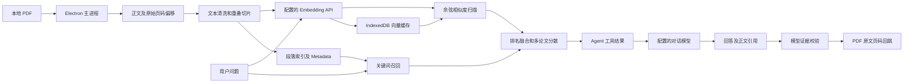

# 架构与技术取舍

本文描述当前 0.1.48 源码。尚未实现的升级见 [路线图](roadmap.md)。

## 运行边界

DeepPaper 是 Electron 桌面应用。渲染进程管理界面、本地文献数据和检索，主进程负责文件访问、PDF 文本提取和模型 HTTP 请求；二者通过 preload 暴露的 IPC 方法通信。

## 模块职责

| 文件 | 职责 |
| --- | --- |
| `electron/main.js` | 文件选择与读取、PDF 文本及页码提取、对话和 Embedding API、请求重试 |
| `electron/preload.js` | 向渲染进程暴露有限的 IPC 方法 |
| `app.js` | 文献库、解析结果、关键词、合集、配置和导入导出 |
| `pdf-reader.js` | PDF.js 画布与文本层、页内搜索、历史语料定位 |
| `library-ai.js` | 论文级关键词召回、前 30 篇候选的模型筛选 |
| `rag.js` | 页级清洗、段落切片、关键词和向量融合检索、上下文读取 |
| `vector-store.js` | IndexedDB 持久化、向量复用、批次缩减、Metadata 更新 |
| `agent.js` | 任务状态、工具执行、引用解析、证据校验及合集确认 |

渲染脚本按 `app → pdf-reader → library-ai → rag → vector-store → agent` 加载。部分能力依赖全局对象；当前没有前端框架、依赖注入容器或独立后端服务。

## 知识入库

1. 解析 PDF 正文，保存原始 PDF 页码及文本偏移；页码指 PDF 文件内的位置，可能与论文印刷页码不同。
2. 规范 Unicode 连字、软连字符和空白；用启发式规则修复部分英文跨行断词，过滤重复页眉页脚及独立页码。
3. 在页内按段落和句子边界切分，默认目标约 820 字符、overlap 约 120 字符。单位是字符，不是 token；实际长度受边界影响。
4. 保留论文 ID、标题、章节、页码、页内偏移、清洗版本和内容哈希。旧数据的精确页码可从仍可访问的本地 PDF 补全；无法补全时标记估算页码。
5. 启用 Embedding 时，仅为缺失内容生成向量；同一配置下重复正文复用向量。默认批量 16 段，特定服务错误会缩小批次，主进程另有有限重试。

清洗后的字符偏移用于页内检索定位，并非原始 PDF 字形坐标。复杂排版和断词规则仍可能产生误差，需要评测验证。

## 检索与存储

向量库存储是 IndexedDB 数据库 `deeppaper.semantic-index.v1` 的 `passage_vectors` 对象仓库。每条记录包含 `Float32Array` 向量、模型名、维度、内容哈希和 Metadata。缓存按 API 地址和模型名区分；当前不能识别服务商在同一模型名后替换权重的情况。

检索时加载当前配置的记录，检查正文哈希，并逐段计算余弦相似度。关键词和语义各取最多 60 段候选，通过带权倒数排名融合及额外奖励项排序，再限制单篇论文占比。当前是线性扫描，没有 HNSW/IVF 等 ANN 索引。`rag.js` 的混合检索最多返回 24 段，Agent 工具另限制最多 20 段，默认 12 段。

“全库 AI”和“段落 RAG”是两条不同路径：前者根据论文级字段召回，最多将 30 篇交给模型筛选；后者针对正文段落取证。向量未配置、未建好或请求失败时，段落检索回退到关键词模式。

文献、配置、语料、合集和任务历史使用 localStorage；向量使用 IndexedDB。当前 JSON 文献库导出包含文献、语料、合集及对话/Agent 状态，不包含 API 配置、PDF 文件字节或向量缓存。

## Agent 执行

模型通过对话接口返回 JSON 指令；主进程校验工具名称，渲染进程执行本地工具并回传结果。当前不是厂商原生 `tools/function calling` 协议，也未接入 LangChain、LangGraph 或 LangSmith。

可用工具为 `search_library`、`search_passages`、`read_passages`、`read_papers`、`compare_papers`、`build_evidence_map` 和 `propose_collection`。任务最多执行 6 步，历史最多保留 12 个任务。合集工具只提出方案，经用户确认后写入。

“证据图谱”当前是跨论文结构化证据表，不是图数据库。最终校验把回答和引用片段再次发送给模型，标记支持程度；它不是形式化验证，也不能保证消除幻觉。任务历史可持久化，但尚不支持中断后从任意执行节点恢复。

## 工程取舍与边界

- Electron 降低桌面文件和 PDF 阅读器的集成成本，代价是安装包体积和桌面运行时维护。
- IndexedDB 无需独立数据库进程；全量加载和线性扫描的延迟、内存上限尚待真实数据压测。
- 自定义工具循环依赖少，但严格参数 schema、取消请求及断点恢复仍需完善。
- API Key 当前以明文结构保存在本地配置中；已开启 `contextIsolation`、关闭 `nodeIntegration`，但渲染进程 `sandbox` 当前关闭。密钥存储与 IPC 加固列入后续工作。
- PDF OCR、表格结构恢复和跨双栏阅读顺序不是当前已保证的能力。

数据流及备份范围详见 [数据与隐私](data-and-privacy.md)。
