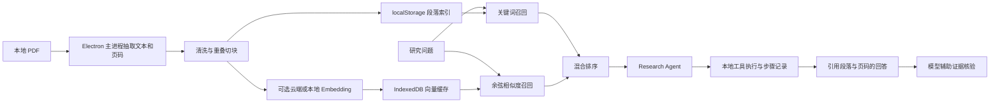

# DeepPaper 项目制作说明

## 项目简介

DeepPaper 是面向学术研究者的 Windows 桌面文献工作区。它把本地 PDF 管理、论文结构化阅读、全文检索、可选语义检索和多步 Research Agent 放在同一应用中，重点解决“论文分散、跨论文对照费时、结论难以回到原文核验”的问题。

本项目是个人作品，源码保留版权。文中技术与能力描述对应当前仓库实现；离线评测框架已经具备，但真实论文标注集上的效果指标尚未完成，不宣称具体准确率或性能提升。

## 解决的问题

| 研究工作中的问题 | DeepPaper 的处理方式 |
| --- | --- |
| PDF、解析结果与阅读位置分散 | 本地导入和管理 PDF，使用内置 PDF.js 阅读器，保留 PDF 页码、段落位置和阅读锚点 |
| 快速了解单篇论文耗时 | AI 抽取动机、贡献、方法、数据集、指标、结果和关键词，并支持围绕论文继续提问 |
| 在个人文献库中找相关研究困难 | 先按论文标题、摘要、关键词等字段本地召回候选，再交给配置的对话模型综合判断 |
| 只按关键词难以定位正文证据 | 将 PDF 正文清洗并切块，按页码保存 Metadata；使用关键词召回和可选 Embedding 向量检索，再融合排序 |
| 跨论文比较缺少结构 | Agent 通过受限工具读取论文、正文段落并构建证据表，回答中提供论文和段落引用 |
| AI 过程难追踪、失败后需重来 | Agent 保存步骤状态、工具参数、结果摘要和耗时；失败或停止后可从保留上下文重试，运行中的模型请求可取消 |

## 技术栈

| 层次 | 技术 | 用途 |
| --- | --- | --- |
| 桌面应用 | Electron 33、Node.js 22 | Windows 桌面窗口、文件访问、模型请求和安装包 |
| 用户界面 | 原生 HTML、CSS、JavaScript | 无前端框架依赖的三栏文献工作区、阅读器、配置与 Agent 面板 |
| PDF 阅读 | PDF.js 5.6、pdf-parse | 文档渲染、文本层选择、文本与页码抽取 |
| 本地数据 | localStorage、IndexedDB | 论文、解析内容、语料、合集、Agent 历史及段落向量缓存 |
| 文本检索 | 自建关键词检索、混合排名 | 在本地论文和清洗后的正文段落中召回候选 |
| Embedding | OpenAI 兼容接口、火山引擎接口、可选本地 Ollama | 将正文段落编码为向量；Ollama 模式下向量化请求留在本机 |
| 语义检索 | JavaScript 余弦相似度 + IndexedDB | 向量持久化和相似度扫描；当前不是 FAISS/Chroma，也没有 ANN 索引 |
| Research Agent | 自建 JSON 工具协议、Electron IPC | 规划并逐步调用本地检索、段落阅读、论文比较和证据整理工具 |
| 测试与构建 | Node.js 检查脚本、Electron E2E、electron-builder、GitHub Actions | 单元/静态检查、桌面端冒烟测试、Windows portable 构建和 CI |

## 架构与数据流

Agent 每轮由对话模型返回一个 JSON 决策，本地应用校验工具名和参数后执行工具，再将结果交回模型。工具执行受到参数 Schema、最大轮数和结果长度约束；创建合集等写入行为需要用户确认。当前使用自建编排，不依赖 LangChain、LangGraph，也不是厂商原生 Function Calling。

## 关键工程取舍

- **桌面端优先**：论文文件与解析流程可在本机管理，降低部署和服务端维护成本；使用云端聊天或云端 Embedding 时，相关问题、论文片段或图像仍会发送给所选服务商。
- **先做可移植的轻量存储**：IndexedDB 直接保存向量，避免额外数据库服务；代价是当前向量查询需线性扫描，较大语料的延迟和内存尚待基准测试。
- **检索可降级**：未配置向量模型或语义检索失败时，正文检索回退到关键词模式；支持云端接口与本地 Ollama Embedding 两种路径。
- **证据优先**：Agent 必须先调用本地工具，引用被限制在真实检索结果；页码信息来自 PDF 页面位置，扫描件 OCR 和复杂版面仍有限制。
- **依赖保持克制**：用原生 JavaScript 和明确的工具协议保持桌面打包简单；后续是否引入图式 Agent 框架，应由流程复杂度和测量结果决定。

## 当前验证与限制

- `npm test`：语法检查和固定样例检查覆盖 PDF 阅读、论文检索、RAG、向量存储、Agent 参数 Schema、取消/重试相关逻辑和评测工具。
- `npm run test:e2e`：使用合成 PDF 和本地模拟 Embedding 服务验证 Electron 阅读器、选中文字锚点、数据持久化及语义检索集成；它不验证真实模型回答质量。
- 私有工作区已有 44 道 draft 问题及多轮检索/切块探索报告，但报告明确标记为未经验证，且有问题证据映射/标注不完整。它们只能作为开发诊断材料，不能用于简历中的 Recall/MRR 或性能提升结论。
- 正式 RAG 评测仍需人工逐条打开原 PDF 核对问题、答案性、逐字证据和页码，再固定 development/test；完成前不报告真实质量提升。私有 PDF、语料全文、问题及逐条排名报告不进入公开仓库。
- `npm run dist` 可生成 Windows portable 包；发布包必须与经过验证的源码提交一致。当前本地构建通过不等于 GitHub Release 已发布或 GitHub Actions 远程通过。
- 当前向量库是 IndexedDB 中的自定义记录仓库，余弦相似度为线性扫描；尚未引入 FAISS、Chroma、HNSW 或 IVF。
- Agent 历史和 API 配置保存在本地；API Key 当前没有系统级加密。应用不是完全离线产品，云端 AI 功能会发送请求到用户配置的服务商。
- 当前 Agent 支持从已保存上下文重试，不等同于任意指令级的事务恢复；本地副作用通过用户确认控制。跨关闭重启后的自动续跑、完整审计导出及更大规模可靠性评测仍可继续加强。

## 简历表述参考

**DeepPaper｜本地优先学术文献 Research Agent**

基于 Electron、原生 JavaScript、PDF.js 与 IndexedDB 构建 Windows 学术文献工作区；实现 PDF 页码感知的清洗切块、关键词/Embedding 混合检索、受 Schema 约束的多步 Agent 工具执行、执行轨迹与取消/重试，以及带原文定位的证据回答。构建离线 RAG 评测脚手架，支持 Recall@K、MRR、页码命中和延迟对比。

面试或简历中如需量化检索效果，应先在去重且划分明确的真实标注文献集上运行评测，再填写实测数字。
